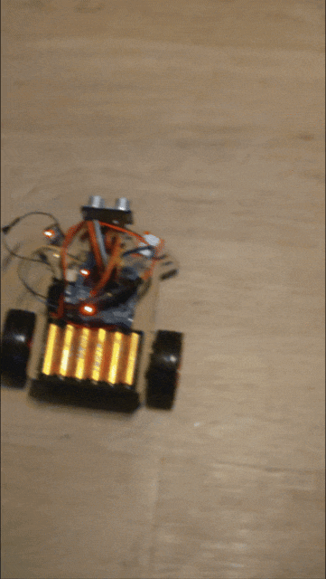
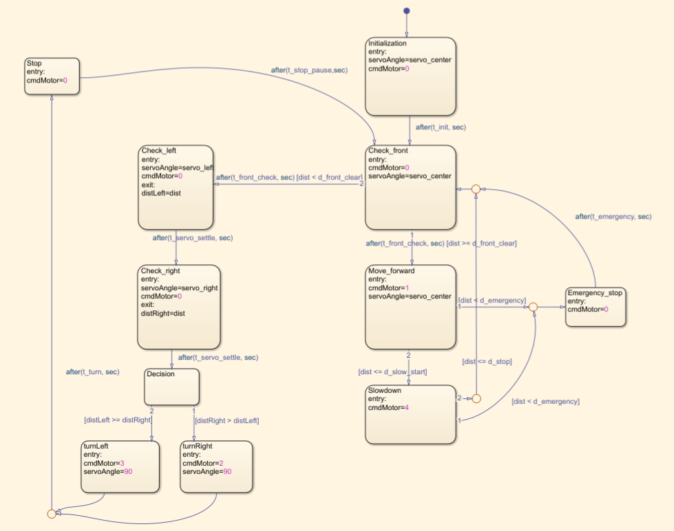

# Autonomous Obstacle-Avoiding Robot Car (Simulink + Stateflow)

A 2WD robot car that drives forward, slows down as it approaches an obstacle, stops, scans left and right with an ultrasonic sensor on a servo, then turns toward the freest side. The whole behavior is built as a **Simulink** model with a **Stateflow** state machine, and deployed to an **Arduino UNO** board.

## Hardware

| Part | Role |
|---|---|
| Arduino UNO R3 | Microcontroller |
| L298N H-bridge driver | Drives the two DC motors |
| 2x DC motors (2WD chassis) | Propulsion |
| SG90 servo (pin 4) | Rotates the ultrasonic sensor |
| HC-SR04 ultrasonic sensor | Distance measurement |
| DHT22 | Temperature (used to correct the distance) |
| Battery pack | Power supply (see note below) |

### Wiring

| Signal | Arduino pin |
|---|---|
| Servo | 4 |
| L298N IN1 / IN2 (right motor) | PIN 7 / PIN 9 |
| L298N IN3 / IN4 (left motor) | PIN 10 / PIN 11 |
| L298N ENA / ENB (PWM) | PIN 5 / PIN 6 |
| HC-SR04 trigger / echo | PIN 16 / PIN 15 |
| DHT22 (temperature only) | PIN 3 |

> Use fully charged batteries when testing. Motor speed and turn angles change as the battery drains, so results from half-empty batteries are not comparable.

> You can find the chassis and most of the parts in this kit: https://fr.aliexpress.com/item/1005003375983337.html

## Requirements

* **MATLAB** (developed with R2026a)
* **Simulink**
* **Stateflow**
* **Simulink Support Package for Arduino Hardware**: provides the blocks for the servo, the HC-SR04, the DHT22 and the digital/PWM outputs, and builds and uploads the program to the board

No Arduino library has to be installed by hand: the support package handles it. The median filter and the motor decoder are plain MATLAB Function blocks and need no extra toolbox.

## Getting started

1. Open the project folder in MATLAB.
2. Open `SmartRobotCar.slx`. The file `params.m` is loaded automatically (it is set as the model's `PreLoadFcn`). If you see "undefined variable" errors, run `params.m` manually.
3. Select your Arduino board and COM port in the model settings.
4. Click **Build, Deploy & Start**.
5. After power-up, the car waits 15 seconds (`t_init`) before moving.

## How it works

### State machine (`car modes`)

* **Initialization**: waits `t_init` seconds with the motors off.
* **Check_front**: looks straight ahead. If the front is clear, it goes forward; otherwise it scans.
* **Move_forward**: drives at full speed. Goes to **Slowdown** when the obstacle is closer than `d_slow_start`.
* **Slowdown**: speed decreases linearly with distance. At `d_stop` the car stops and returns to Check_front.
* **Check_left / Check_right**: the servo turns the sensor to 135° and 45°, and the distance is stored for each side.
* **Decision**: turns toward the side with the larger distance.
* **turnLeft / turnRight**: turns in place for a fixed time, then **Stop** and back to Check_front.
* **Emergency_stop**: triggered if an obstacle appears closer than `d_emergency` while driving.

### Distance measurement

HC-SR04 reading, a 3-sample median filter (removes isolated bad readings), and an exponential low-pass filter (`alpha`). The distance is then corrected in the "distance correction" block using the temperature reading from the DHT22.

### Motor control (`cmdMotor`)

Stateflow sends a command code to the `motor_decoder` function, which sets the L298N direction pins and PWM speeds.

| `cmdMotor` | Meaning |
|---|---|
| 0 | Stop (active brake) |
| 1 | Forward |
| 2 | Turn right |
| 3 | Turn left |
| 4 | Slowdown (PWM decreases linearly from `v_forward` to `v_min` between `d_slow_start` and `d_stop`) |

## Parameters (`params.m`)

All tunable values live in `params.m`. Change a value there and redeploy.

| Parameter | Default | Description |
|---|---|---|
| `v_forward` | 130 | Forward speed (PWM, 0-255) |
| `v_min` | 90 | Minimum speed while slowing down (keep above the motor stall threshold) |
| `v_turn` | 120 | Speed while turning in place |
| `offset_right` / `offset_left` | 0 | PWM added to one motor to compensate drift |
| `d_slow_start` | 1.30 m | Distance where slowing down begins |
| `d_stop` | 0.60 m | Distance where the car brakes |
| `d_front_clear` | 0.90 m | Front is considered clear above this distance |
| `d_emergency` | 0.38 m | Emergency stop distance |
| `servo_center` / `servo_left` / `servo_right` | 90 / 135 / 45 | Servo angles (degrees) |
| `t_init`, `t_front_check`, `t_servo_settle`, `t_turn`, `t_stop_pause`, `t_emergency` | see file | State durations (seconds) |
| `alpha` | 0.2 | Low-pass filter coefficient (higher = faster but noisier) |

## Calibration

Every robot is different (motors, battery, floor). Expect to tune these values:

* **Drift in a straight line**: if the car drifts left, increase `offset_left`; if it drifts right, increase `offset_right`. Both are 0 by default.
* **Stopping distance**: the car keeps moving after braking. Measure where it stops and adjust `d_stop`.
* **Turn angle**: turns are timed, not measured. Adjust `t_turn` until each turn is about 45°.
* **Motors not moving at low speed**: raise `v_min` and `v_turn`.

## Known limitations

* Turns are open-loop (timed), so the angle depends on battery level and floor grip.
* The car drifts slightly in a straight line (no heading correction yet).
* The HC-SR04 and DHT22 reads can take longer than the model's 10 ms step, which can stretch the timed states.

## Roadmap

* Implement remote control functionality for the vehicle

## Repository content

* `SmartRobotCar.slx`: Simulink model (Stateflow chart, motor control, ultrasonic subsystem)
* `params.m`: tunable parameters
* `media/`: demo GIF and Stateflow screenshot used in this README
* `.gitignore`: excludes Simulink cache, generated code and build outputs
